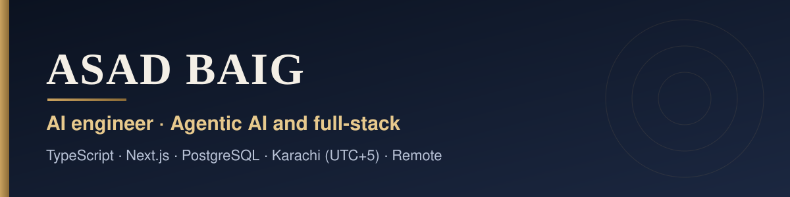
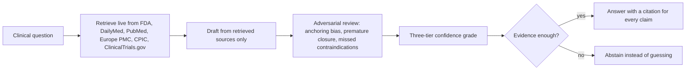

  

  
  
  
  
  
  

### I build AI products that hold up in production, and every one is live for you to open.

My source code is private because it belongs to commercial products and clients. So instead of repositories, here is proof you can click.

| | |
| :-- | :-- |
| **31** tools in one medical AI workspace | **158** API routes behind it |
| **1,200+** commits on that one product | **316** automated test cases |

## Live products

| Product | What it does | Proof |
| :-- | :-- | :-- |
| [**CiteWard**](https://citeward.com) | Evidence-first medical AI. Every claim cites a retrieved source, and it abstains when evidence is missing. | 31 tools, live retrieval from FDA, DailyMed, PubMed, Europe PMC, CPIC and ClinicalTrials.gov |
| [**Illyria**](https://illyria.vercel.app) | Multi-tenant hotel operating system with an AI inbox across WhatsApp, Instagram, Messenger and web chat. | 260 pages, 100+ database tables, 68 test files, English and Albanian |
| [**Celesya**](https://celesya.com) | Personalised conversational AI guide with profile-based readings, chat and decision rooms. | Next.js, Vercel AI SDK, Groq |
| [**PrepsNext Hub**](https://prepsnext.com/hub) | Recruiting platform for high school athletes, with a promotion auction where only winners pay. | 3 live Stripe money flows, 278 commits |
| [**PrepsNext Coach Portal**](https://coaches.prepsnext.com) | Recruiting CRM for college coaches. | 32 pages, 15 data models |
| [**TextileWays**](https://www.textileways.com) | Manufacturer site with an SEO control system: the build fails on duplicate titles, descriptions or H1s. | 199-URL page map, 14 landing pages, 308 redirects for 68 renamed pages |
| [**NovoStitches**](https://novostitches.com) | Denim and leather manufacturer site on a custom WordPress theme and plugin. | SEO overhaul across 134 URLs, quote form cut from 23 fields to 4 |
| [**Herbiix**](https://herbiix.com) | Food store with a tool-calling AI kitchen. | 25-check evaluation suite |
| **Kynnected** | Expo and React Native accountability app with 8 AI mentors. | 56 screens, 24 database migrations |

## How a CiteWard answer is produced

## How I work

- **Agents that fail safely.** Guardrails, human handover, evaluation suites, and answers that show their sources.
- **AI coding agents every day, verified every time.** Tests, root-cause debugging and a failing build when something drifts.
- **Specific over generic.** A leaked migration lock behind a pooled database connection, found and fixed, beats a vague claim.

## Stack

`TypeScript` `Next.js` `Node.js` `React` `React Native (Expo)` `PostgreSQL` `Prisma` `Drizzle` `Supabase` `Redis` `Stripe` `Playwright` `Vitest` `Jest` `WordPress` `Vercel`

## Work with me

I am open to remote full-time or contract roles as an **Applied AI Engineer**, **Full-Stack AI Engineer** or **AI Agent Engineer**, and to relocation where an employer sponsors a visa. Pick any product above and tell me what you want to check. I will walk you through how it works.

**Email** asadexcision@gmail.com · **LinkedIn** [linkedin.com/in/propugnator](https://www.linkedin.com/in/propugnator)
